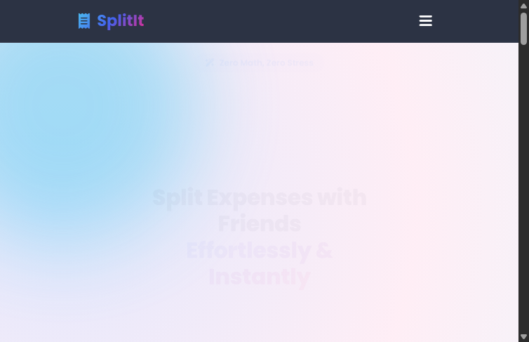
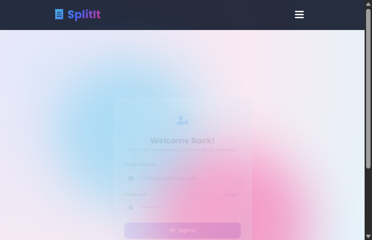
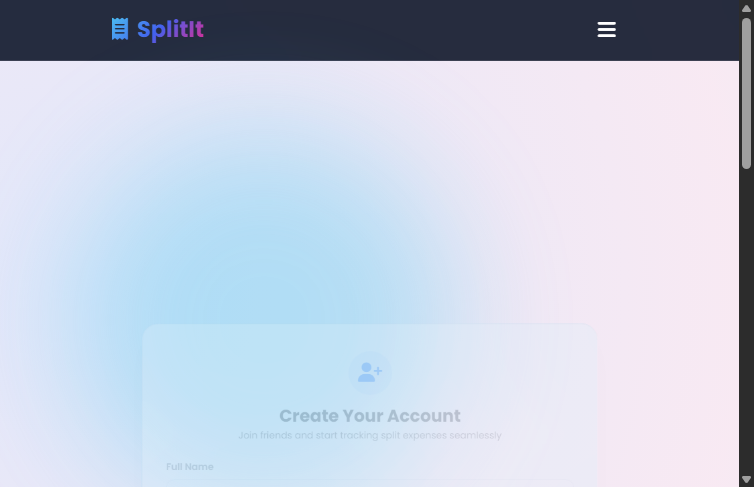

# 💸 SplitIt: Group & Personal Finance Tracker

[](https://www.php.net/)
[](https://www.mysql.com/)
[](https://getbootstrap.com/)
[](LICENSE)

**SplitIt** is a full-featured financial management web application designed to handle both personal expenses and group expense splitting seamlessly. Say goodbye to awkward money conversations and spreadsheet headaches—track group vacations, flatmate utilities, dining out, and personal budgets in real-time.

---

## 🌐 Live Demo & Public Link

🔗 **Permanent Live URL:** [https://clique-evaluator-ramble.ngrok-free.dev/project/](https://clique-evaluator-ramble.ngrok-free.dev/project/)  
*(Access directly in your browser. If prompted by the Ngrok free tier screen, click **"Visit Site"** to proceed.)*

---

## 📸 Live Application Screenshots

### 🏠 Public Landing & Interactive Split Calculator
> Features dynamic floating badges, Animate-on-Scroll (AOS) effects, and an interactive bill-splitting calculator.


### 🔐 Modern Glassmorphic Login & Authentication
> Responsive authentication interface with floating ambient glow and form validation.


### 📝 User Registration & Payment QR Upload
> Secure user registration supporting payment QR code and profile picture uploads.


---

## 🚀 Key Features

### ⚡ Interactive Split Simulator (New)
* **Instant Calculation:** Slide friend count and bill amount for dynamic real-time equal share calculations with micro-animations.

### 👥 Group Expense Splitting
* **Create & Manage Groups:** Establish shared circles for roommates, trips, dinners, or events.
* **Smart Splitting Engine:** Input bills and allocate shares dynamically among group members.
* **Settle Up via QR Codes:** Upload and display UPI/Payment QR codes for quick, dispute-free reconciliation.
* **Dues Ledger:** View transparent breakdowns of pending balances and recorded settlements.

### 👤 Personal Expense Management
* **Add & Edit Expenses:** Record daily transactional data with categories and timestamps.
* **Smart Visual Dashboard:** Real-time metrics tracking today's, yesterday's, last 7 days', and total expenses.
* **Dynamic Reporting:** Generate detailed expense statements broken down day-wise, month-wise, or year-wise.

---

## 🛠️ Tech Stack

* **Frontend:** HTML5, CSS3, JavaScript (ES6+), Bootstrap 5, AOS (Animate On Scroll), FontAwesome 6
* **Backend:** PHP (OOP & Procedural)
* **Database:** MySQL / MariaDB (`detsdb`)
* **Web Server:** Apache (XAMPP environment)
* **Tunneling / Deployment:** Ngrok & Cloudflare Tunnels

---

## 📁 Repository Structure

```text
├── assets/                 # Third-party styling libraries and static fonts
├── css/                    # Compiled stylesheets with animation rules
├── sass/                   # Modular SASS codebases defining UI layers
├── js/                     # Component scripts managing client-side events
├── images/                 # Graphical assets, illustrations, and live previews
│   ├── preview.png         # Live home screenshot
│   ├── preview_login.png   # Live login screenshot
│   ├── preview_register.png# Live registration screenshot
│   ├── profile/            # User profile photos
│   └── qr/                 # User payment QR codes
├── includes/               # Reusable modular code blocks (headers, navigation, footers)
│
├── config.php              # Global environment configuration and MySQL connection
├── index.php               # Public gateway / platform welcome page with animations
├── login.php               # User identification and credentials verification page
├── register.php            # New profile generation system
├── logout.php              # Session destruction controller
│
├── dashboard.php           # Unified personal overview panel
├── add-expense.php         # Personal expense ledger processing
├── manage-expense.php      # Directory for modifying or deleting personal expense history
│
├── create-group.php        # Group profile initiation engine
├── group_dashboard.php    # Aggregated overview panel for team expenses
├── manage-group.php        # Member lists and administrative control panel
├── split_expense.php       # Transaction split distribution logic
├── pay_expense.php         # Payment processing and reconciliation engine
├── pending_dues.php        # Balance logs tracking un-settled debts
│
├── expense-reports.php     # Report configuration and date range filters
├── detsdb (11).sql         # Database foundational architecture dump
└── start_permanent_url.bat # One-click launcher for Apache, MySQL, and Ngrok tunnel
```

---

## 💻 Installation & Local Setup

### 1. Prerequisites
Ensure you have [XAMPP](https://apachefriends.org) or any standard PHP 7.4+ / MySQL environment installed.

### 2. Clone the Repository
```bash
git clone https://github.com/praptidhote/Splitit-Group-And-Personal-Finance_Tracker.git
```

### 3. Move to Web Root
Place the project folder inside your local server's public directory (e.g. `C:\xampp\htdocs\project`).

### 4. Database Setup
1. Launch **phpMyAdmin** through your browser (`http://localhost/phpmyadmin`).
2. Create a new database named `detsdb`.
3. Import the `detsdb (11).sql` file located in the root of the project.

### 5. Launch
- Start Apache and MySQL in XAMPP.
- Open your browser and navigate to:
  ```text
  http://localhost/project/index.php
  ```
- Or run `start_permanent_url.bat` to launch the local servers and the public Ngrok tunnel simultaneously.

---

## 👤 Author & Profile

* **Developer:** Prapti Dhote
* **GitHub Profile:** [@praptidhote](https://github.com/praptidhote)
* **Repository:** [Splitit-Group-And-Personal-Finance_Tracker](https://github.com/praptidhote/Splitit-Group-And-Personal-Finance_Tracker)

---

## 📄 License
This project is open-source and available under the [MIT License](LICENSE).
